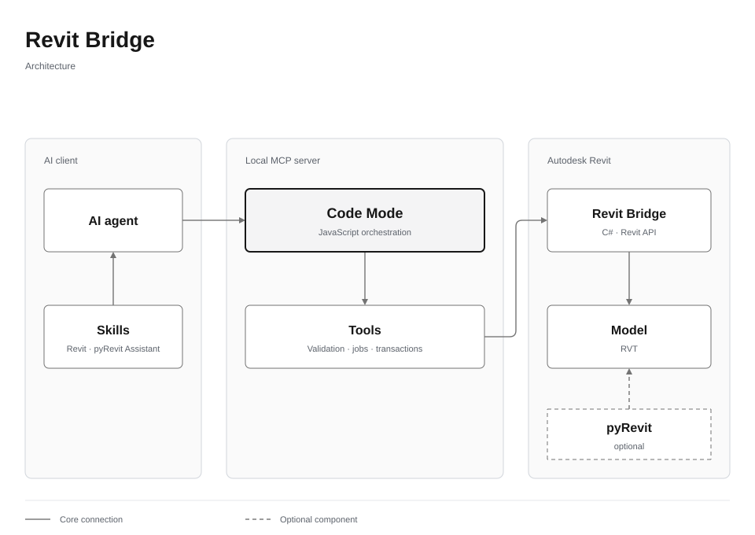

# Revit Bridge

[English](README.md) · [Русский](README.ru.md)

Connect AI coding agents to Autodesk Revit through a local MCP server and guarded .NET add-in. Includes **28 MCP tools**, **seven generic skills** and **pyRevit Assistant**.



## Features

- Discover Revit installations, sessions, documents and local models.
- Run protected C# queries, API signature lookup, previews and managed edits.
- Inspect durable jobs, cancel pending work and reserve a multi-step workflow.
- Process independent modeling items in short transactions, preserving prior element identities.
- Read warnings and verify results independently after commit.
- Save RVT and export generic IFC through explicit lifecycle tools.
- Author pyRevit buttons and inspect PDF/DXF/FBX/OBJ reference geometry.

**Code Mode is planned, not included:** its separate source was not found in the available inventory. Existing C# execution through MCP is implemented and is a different capability.

## Install

Windows, Revit 2025/2026 and [Node.js 22+](https://nodejs.org/en/download) are required. Installing from source also needs the [.NET 8 SDK](https://dotnet.microsoft.com/download/dotnet/8.0). An archive with compiled `server/bin/<year>/` does not need the SDK for installation.

Run PowerShell in the extracted directory:

```powershell
.\install.ps1 -Years 2025 -WorkspaceRoot 'C:\RevitModels' -Language en
```

The installer builds a missing bridge, installs locked Node dependencies, writes machine-local configuration and registers the add-in. Restart Revit normally. Register the MCP entry from `server/mcp-client.local.json` in your client, preserving existing settings. For skills, pass `-SkillsPath` with your client's chosen skills directory; existing same-name directories are refused.

[pyRevit](https://github.com/pyrevitlabs/pyRevit/releases) is optional for Python tools, not required by the C# bridge. External drawing helpers use Python and `requirements-tools.txt` outside Revit's interpreter.

## Check

```powershell
node server/doctor.mjs
node server/probe.mjs --list
npm test --prefix server
```

Have your agent read `skills/revit-bridge/SKILL.md`, select exact live session/document IDs, and start with a read-only query.

## Build and remove

```powershell
.\build.ps1 -Years 2025,2026
.\install.ps1 -Years 2025 -CheckOnly
.\install.ps1 -Years 2025 -Remove
```

Keep the registered directory in place. A running Revit process retains its old DLL until restarted. Removal unregisters this product only; it does not delete model data.

## Documentation

[Install](docs/INSTALL.md) · [Skills](docs/SKILLS.md) · [Execution contract](docs/EXECUTION.md) · [Validation](docs/VALIDATION.md)

The extracted bridge builds for 2025/2026 but has not been loaded into live Revit during packaging. Model rollback does not sandbox arbitrary C# file/network/process effects. No license for the owner's source has been selected; third-party components retain their own terms: [THIRD_PARTY.md](THIRD_PARTY.md).
