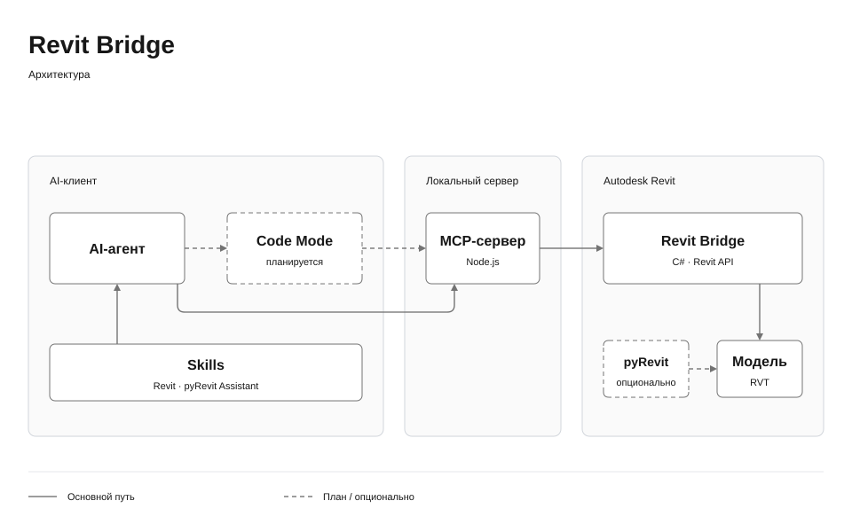

# Revit Bridge

[English](README.md) · [Русский](README.ru.md)

Локальный комплект для работы AI-агента с Autodesk Revit: **Code Mode**, MCP-сервер и защищённое выполнение Revit API через .NET-надстройку. Два основных MCP-инструмента предоставляют **28 операций Revit**, **семь универсальных навыков** и **pyRevit Assistant**.



## Возможности

- Поиск схем операций через `revit_tools`; объединение вызовов, циклов и обработки результатов в `revit_code_mode`.
- Поиск Revit, сеансов, документов и локальных моделей.
- Чтение через C#, справочник API, предпросмотр и управляемые изменения.
- Устойчивые задания, отмена ожидающих операций и резервирование многошаговой работы.
- Короткие порции моделирования с сохранением идентичности ранее созданных элементов.
- Предупреждения и отдельная проверка результата после commit.
- Явное сохранение RVT и обычный экспорт IFC.
- Кнопки pyRevit и помощники для геометрии PDF/DXF/FBX/OBJ.

**Code Mode — основной интерфейс по умолчанию.** JavaScript объединяет существующие операции; защищённый C# выполняется внутри Revit. [Описание и примеры](docs/CODE_MODE.ru.md). Для клиентов, которым нужны прямые инструменты, задайте `REVIT_BRIDGE_TOOLSET=full`: будут доступны все 28 операций и два основных инструмента.

```javascript
const sessions = await revit.call('revit_sessions', {});
return sessions.map(s => ({ sessionId: s.sessionId, year: s.year }));
```

## Установка

Нужны Windows, Revit 2025/2026 и [Node.js 22+](https://nodejs.org/en/download). Для установки из исходников также нужен [.NET 8 SDK](https://dotnet.microsoft.com/download/dotnet/8.0). Если архив содержит готовый `server/bin/<год>/`, SDK для установки не требуется.

Откройте PowerShell в распакованной папке:

```powershell
.\install.ps1 -Years 2025 -WorkspaceRoot 'C:\RevitModels' -Language ru
```

Установщик собирает недостающий мост, устанавливает зафиксированные Node-зависимости, создаёт локальные настройки и регистрирует надстройку. Затем штатно перезапустите Revit. Добавьте MCP-запись из `server/mcp-client.local.json` в настройки агента, сохранив другие подключения. Для навыков передайте `-SkillsPath` с каталогом вашего клиента; одноимённые каталоги не перезаписываются.

[pyRevit](https://github.com/pyrevitlabs/pyRevit/releases) нужен для необязательных Python-инструментов. C#-мост его не требует. Помощники разбора геометрии используют внешний Python и `requirements-tools.txt`.

## Проверка

```powershell
node server/doctor.mjs
node server/probe.mjs --list
npm test --prefix server
```

Попросите агента прочитать `skills/revit-bridge/SKILL.md`, выбрать актуальные UUID сеанса и документа и начать с чтения.

## Сборка и удаление

```powershell
.\build.ps1 -Years 2025,2026
.\install.ps1 -Years 2025 -CheckOnly
.\install.ps1 -Years 2025 -Remove
```

Не перемещайте зарегистрированную папку. Открытый Revit использует прежнюю DLL до перезапуска. Удаление снимает регистрацию только продукта; модели не удаляются.

## Документация

[Установка](docs/INSTALL.ru.md) · [Code Mode](docs/CODE_MODE.ru.md) · [Навыки](docs/SKILLS.ru.md) · [Контракт](docs/EXECUTION.ru.md) · [Проверки](docs/VALIDATION.ru.md)

Новый комплект собран для 2025/2026, но при упаковке в живой Revit не загружался. Транзакции не изолируют внешние файлы, сеть и процессы произвольного C#. Лицензия собственных исходников пока не выбрана; сторонние компоненты сохраняют свои условия: [THIRD_PARTY.md](THIRD_PARTY.md).
